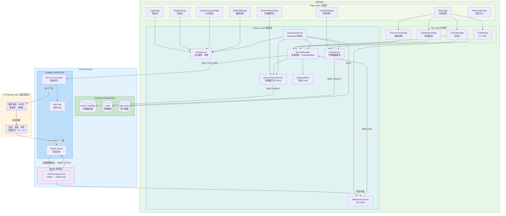
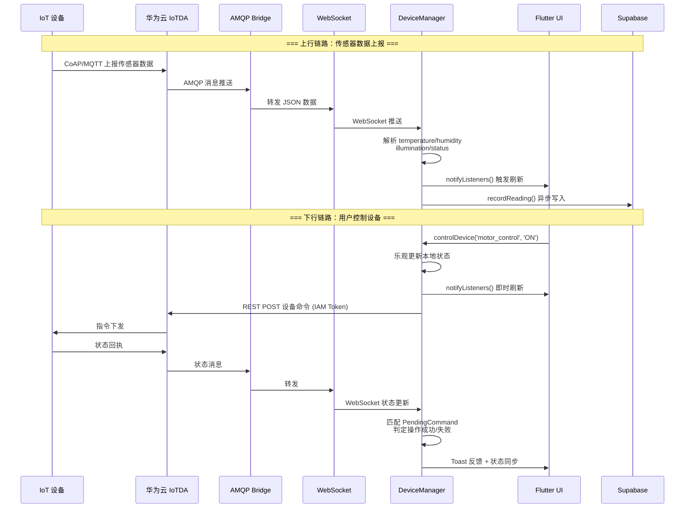

# 禾寻 — 智能农业物联网 App

基于 Flutter 开发的智能农业物联网移动端应用，连接华为云 IoTDA 设备管理平台与 Supabase
云数据库，实现温室大棚传感器数据实时监测、设备远程控制、历史趋势分析、作物管理与天气服务。
内置完整的认证系统（注册/登录/忘记密码/个人资料编辑），支持自动登录与 SHA-256 盐值加密。

---

## 系统架构



### 数据流转图



### 三层架构总览

```mermaid
graph LR
    subgraph L1["Presentation 表现层"]
        A1[LoginPage]
        A2[RegisterPage]
        A3[ForgotPasswordPage]
        A4[EditProfilePage]
        A5[MainPage]
        A6[SensorHistoryPage]
        A7[CropDetailPage]
        A8[AlertCenterPage]
    end

    subgraph L2["Business 业务逻辑层"]
        B1[AuthService]
        B2[WeatherService]
        B3[DeviceManager]
        B4[SensorHistoryService]
        B5[CropService]
        B6[SupabaseService]
    end

    subgraph L3["Data 数据层"]
        C1[WebSocket<br/>实时数据流]
        C2[Supabase REST API<br/>业务数据]
        C3[IoTDA REST API<br/>设备控制]
    end

    L1 --> L2 --> L3
```



### 数据流转

1. **上行（设备 → App）**：温室传感器通过 CoAP/MQTT 上报数据至华为云 IoTDA → 经 AMQP 队列推送至
   `HwIoTAmqpClient.js` Node.js 桥接服务 → 通过 WebSocket 广播给 Flutter App → `DeviceManager`
   解析并更新状态、触发 UI 刷新，同时异步写入 Supabase `sensor_readings` 表
2. **下行（App → 设备）**：用户在 App 中触发设备控制 → `DeviceManager` 调用华为云 IAM 鉴权 → 通过 IoTDA
   REST API 下发设备命令 → 设备执行 → 状态回执经上行链路反馈 → App 匹配挂起命令并展示操作结果 Toast
3. **业务数据**：App 通过 Supabase REST API 读写 `crops`、`sensor_readings`、`app_users`
   表，支持传感器历史趋势查询、作物信息管理与用户认证

---

## 技术路线

| 层级            | 技术栈                | 版本                        |
| --------------- | --------------------- | --------------------------- |
| **UI 框架**     | Flutter (Dart)        | SDK ≥3.11.5 / Flutter ≥3.38 |
| **HTTP 客户端** | dio                   | ^5.9.2                      |
| **WebSocket**   | web_socket_channel    | ^3.0.3                      |
| **数据可视化**  | fl_chart              | ^1.2.0                      |
| **云数据库**    | Supabase (PostgreSQL) | supabase_flutter ^2.12.0    |
| **密码加密**    | crypto                | ^3.0.7                      |
| **本地存储**    | shared_preferences    | ^2.5.0                      |
| **物联网平台**  | 华为云 IoTDA          | IAM + 设备接入              |
| **消息桥接**    | Node.js (rhea + ws)   | AMQP 1.0 → WebSocket        |
| **代码规范**    | flutter_lints         | ^6.0.0                      |
| **构建工具**    | Gradle (Kotlin DSL)   | AGP 8.11.1 / Kotlin 2.2.20  |

---

## 目录结构

```
smart_farm_flutter/
├── lib/
│   ├── main.dart                          # 应用入口，初始化 Supabase + 自动登录
│   ├── config/
│   │   ├── config.dart                    # 运行配置（已 gitignore，包含真实密钥）
│   │   └── config_example.dart            # 配置模板
│   ├── models/
│   │   ├── app_user.dart                  # 用户模型（含昵称、头像、简介等）
│   │   ├── crop.dart                      # 作物数据模型（26 字段）
│   │   └── sensor_trend_point.dart        # 传感器趋势点模型
│   ├── routes/
│   │   └── route.dart                     # 路由表 + MaterialApp 配置
│   ├── services/
│   │   ├── auth_service.dart              # 认证服务（注册/登录/忘记密码/自动登录）
│   │   ├── weather_service.dart           # 天气服务（高德 API + 本地缓存）
│   │   ├── device_manager.dart            # 设备管理核心（ChangeNotifier）
│   │   ├── supabase_service.dart          # Supabase 初始化服务
│   │   ├── sensor_history_service.dart    # 传感器历史数据 CRUD
│   │   ├── crop_service.dart              # 作物数据服务
│   │   └── app_feedback.dart              # 全局 Toast 通知
│   └── pages/
│       ├── login_page.dart                # 登录页（用户名/手机号 + 密码）
│       ├── register_page.dart             # 注册页（用户名/手机号/密码）
│       ├── forgot_password_page.dart      # 忘记密码页（手机号验证重置）
│       ├── edit_profile_page.dart         # 编辑资料页（昵称/头像/简介/邮箱）
│       ├── main_page.dart                 # 主页（底部 4 Tab）
│       ├── sensor_history_page.dart       # 传感器历史查询（日历 + 趋势图）
│       ├── crop_detail_page.dart          # 作物详情页
│       └── pageViews/
│           ├── overview_page.dart         # 总览页（农场概览 + 天气卡片 + 大棚卡片）
│           ├── device_control_page.dart   # 设备控制页
│           ├── data_monitor_page.dart     # 数据监测页（实时 + 趋势）
│           ├── alert_center_page.dart     # 告警中心页（一键操作 + 设备跳转）
│           └── profile_page.dart          # 个人中心页（用户信息 + 退出登录）
├── android/                               # Android 原生工程
├── assets/
│   ├── img/                               # 图片资源（logo / avatar / 图标）
│   └── iot_amqp/
│       ├── HwIoTAmqpClient.js             # AMQP-WebSocket 桥接服务
│       └── package.json
├── supabase/
│   ├── schema.sql                         # sensor_readings 建表 + RLS
│   ├── schema_extra.sql                   # crops + app_users 建表 + RLS
│   └── cleanup.sql                        # 30 天数据清理脚本
├── test/
│   └── widget_test.dart                   # 基础 Widget 测试
├── pubspec.yaml
├── .gitignore
└── README.md
```

---

## 核心模块实现

### 1. DeviceManager — 设备管理核心

位置：`lib/services/device_manager.dart`

- **单例模式** + `ChangeNotifier`：全局唯一实例，状态变更时自动通知所有监听 Widget 刷新 UI
- **IAM 认证**：通过华为云 IAM Token API 获取临时令牌，用于后续设备命令调用的鉴权
- **WebSocket 实时数据**：连接至 `HwIoTAmqpClient.js` 建立的 WebSocket 服务，持续接收传感器数据
  JSON，解析并更新 `temperature` / `humidity` / `illumination` / `motorStatus` / `lightStatus` 等状态字段
- **乐观 UI 更新**：用户触发设备开关时，先更新本地状态让 UI 立即响应，再异步发送 REST 命令
- **命令保护窗口（5 秒）**：引入 `_PendingDeviceCommand` 机制，记录每个命令的期望状态和时间戳。在保护窗口内忽略
  WebSocket 回放的旧状态，避免把乐观更新刷回旧值
- **操作反馈**：命令完成或超时后，通过 `AppFeedback.showAppToast()` 弹出成功（绿色）/失败（红色）SnackBar
- **自动记录传感器读数**：每次接收到传感器数据时，调用 `SensorHistoryService.recordReading()` 将数据异步写入
  Supabase

### 2. SupabaseService — 云数据库初始化

位置：`lib/services/supabase_service.dart`

- 惰性初始化：在 `main.dart` 的 `main()` 函数中调用 `SupabaseService.initialize()`
- 配置检查：若 `Config.supabaseUrl` 或 `Config.supabaseAnonKey` 为空则跳过初始化
- 全局访问：通过 `SupabaseService.maybeClient` 获取 `SupabaseClient` 实例，各业务 Service 按需调用

### 3. SensorHistoryService — 传感器历史数据服务

位置：`lib/services/sensor_history_service.dart`

| 方法                    | 功能                                                                                                  |
| ----------------------- | ----------------------------------------------------------------------------------------------------- |
| `recordReading()`       | 将传感器读数写入 `sensor_readings` 表，内置 1 分钟去重防抖                                            |
| `fetchTrend()`          | 按时间范围（24h/7d/30d）查询数据并分桶聚合（24h 按小时、7d 按星期、30d 按日期），返回折线图所需数据点 |
| `fetchRecords()`        | 支持起止日期筛选、升降序、分页（limit）的传感器历史记录查询                                           |
| `fetchAvailableDates()` | 查询所有有数据的日期，为日历组件提供可选日期标记                                                      |

- 土壤湿度兜底估算：若无直接传感器读数，通过温度与湿度的经验公式 `75 - (temp-22)×2 + (hum-60)×0.5`
  估算，并钳位至 [10, 95]

### 4. CropService — 作物数据服务

位置：`lib/services/crop_service.dart`

- 查询 Supabase `crops` 表，按 `crop_name` 排序返回所有作物列表
- 每行数据通过 `Crop.fromSupabase()` 工厂构造函数映射到 `Crop` 模型（26 个字段）

### 5. AppFeedback — 全局 Toast 通知

位置：`lib/services/app_feedback.dart`

- 注册全局 `GlobalKey<ScaffoldMessengerState>` 至 `MaterialApp`，实现跨页面 SnackBar 调用
- 根据消息内容自动判定成功（含"成功"字样，绿色 `#1F7A4D`）或失败（红色 `#B9382F`）
- 自定义弹性动画（`easeOutBack` 展开 / `easeInCubic` 收起）、圆角 15px、浮动样式、水平滑动关闭

### 6. AuthService — 用户认证服务

位置：`lib/services/auth_service.dart`

| 方法                  | 功能                                                                   |
| --------------------- | ---------------------------------------------------------------------- |
| `login()`             | 支持用户名或手机号登录，验证 SHA-256(salt+password) 哈希，返回用户信息 |
| `register()`          | 注册新用户，自动生成 32 字节随机盐值，SHA-256 加密存储密码             |
| `resetPassword()`     | 通过手机号验证身份后重置密码，重新生成盐值并更新哈希                   |
| `checkAutoLogin()`    | App 启动时自动读取 SharedPreferences 中的凭据，静默恢复登录状态        |
| `logout()`            | 清除本地凭据与内存用户状态                                             |
| `updateProfile()`     | 更新用户昵称、头像 URL、简介、邮箱等个人信息                           |
| `getUserByUsername()` | 按用户名查询用户记录                                                   |

- 密码安全性：使用 `dart:crypto` 的 SHA-256 对「密码 + 32 字节随机盐」进行哈希，不存储明文
- 自动登录：登录成功后凭据加密存入 `SharedPreferences`，下次启动自动恢复
- 关联模型：`AppUser`（`lib/models/app_user.dart`），含 username / nickname / avatarUrl / bio / email / phone / profession / farm

### 7. WeatherService — 天气服务

位置：`lib/services/weather_service.dart`

- 对接高德天气 API，获取当前城市的天气实况（天气现象、温度、风力、湿度）
- 本地缓存机制：天气数据缓存至 `SharedPreferences`，网络失败时回退到缓存
- 30 秒刷新间隔：避免频繁请求 API
- 通过 `singleChildScrollView` 的 `GlobalKey` 触发首页天气卡片刷新

### 8. AMQP-WebSocket 桥接服务 (Node.js)

位置：`assets/iot_amqp/HwIoTAmqpClient.js`

- 使用 `rhea` 库通过 AMQP 1.0 over TLS 连接华为云 IoTDA 的消息队列
- 监听 `DefaultQueue`，接收 IoT 设备上报的遥测数据
- 使用 `ws` 库启动本地 WebSocket 服务（端口 8083），将 AMQP 消息实时转发给 Flutter App
- 内建 3 秒心跳保活与自动重连机制

### 9. 数据库设计（Supabase PostgreSQL）

**sensor_readings（传感器读数表）**

| 列            | 类型             | 说明                              |
| ------------- | ---------------- | --------------------------------- |
| id            | bigint (PK)      | 自增主键                          |
| greenhouse    | text             | 大棚标识（如 `east-suburb-farm`） |
| temperature   | double precision | 温度 (°C)                         |
| humidity      | double precision | 湿度 (%)                          |
| illumination  | double precision | 光照 (Lux)                        |
| soil_moisture | double precision | 土壤湿度 (%)                      |
| co2           | double precision | CO₂ 浓度 (ppm)                    |
| ph_value      | double precision | pH 值                             |
| recorded_at   | timestamptz      | 记录时间 (UTC)                    |

索引：`(greenhouse, recorded_at DESC)` 复合索引

**crops（作物表）**：26 个字段，含种植信息、环境分析评分、任务时间等

**app_users（用户表）**：用户名、密码、昵称、联系方式、农场绑定

所有表启用 **Row Level Security (RLS)**，允许匿名用户读/写，便于 App 端免鉴权快速集成。

---

## 页面说明

| 页面                   | 路由               | 功能                                                                                             |
| ---------------------- | ------------------ | ------------------------------------------------------------------------------------------------ |
| **LoginPage**          | `/login`           | 用户名/手机号 + 密码登录；记住密码；注册/忘记密码入口；三方登录入口（微信/QQ）                   |
| **RegisterPage**       | `/register`        | 用户注册：用户名、手机号、密码、确认密码；SHA-256 加密存储                                       |
| **ForgotPasswordPage** | `/forgot-password` | 手机号验证 + 新密码重置                                                                          |
| **EditProfilePage**    | `/edit-profile`    | 编辑个人资料：昵称、头像 URL、简介、邮箱、手机号、职业                                           |
| **MainPage**           | `/main`            | 底部导航 4 Tab：总览、设备控制、数据监测、我的；自动键盘收起                                     |
| **OverviewPage**       | Tab 1              | 动态农场名；设备在线/告警统计；24h 环境均值卡片；高德天气卡片（优秀/良好颜色区分）；大棚卡片列表 |
| **DeviceControlPage**  | Tab 2              | 按设备类型筛选 Tab；设备卡片含属性、运行时长、开关控制（通风/补光走真实 IoTDA，灌溉/水肥为模拟） |
| **DataMonitorPage**    | Tab 3              | 实时数据卡片（温/湿/土/光）；趋势折线图（24h/7d/30d）；跳转历史查询入口                          |
| **SensorHistoryPage**  | `/sensor-history`  | 自定义日历日期选择器；起止日期筛选；记录数量限制；fl_chart 趋势折线图；详细记录列表              |
| **CropDetailPage**     | 导航进入           | 作物基本信息；生长进度条；环境分析 5 维评分；问题与建议卡片                                      |
| **AlertCenterPage**    | `/alert`           | 告警统计卡片；未处理/已处理筛选；一键灌溉/通风；查看设备跳转；左滑忽略持久化；随机生成告警       |
| **ProfilePage**        | Tab 4              | 用户信息展示（头像/昵称/简介/手机/邮箱）；农场卡片；设置菜单；编辑资料入口；退出登录             |

---

## 快速开始

### 前置条件

- Flutter SDK ≥3.38
- Android Studio / VS Code + Flutter 插件
- Node.js (用于运行 AMQP 桥接服务)
- 华为云 IoTDA 实例 + Supabase 项目

### 1. 克隆项目

```bash
git clone <repo-url>
cd smart_farm_flutter
```

### 2. 配置密钥

复制配置模板并填入真实密钥：

```bash
cp lib/config/config_example.dart lib/config/config.dart
```

编辑 `lib/config/config.dart`，填入：

- `supabaseUrl` / `supabaseAnonKey`：Supabase 项目 URL 和匿名密钥
- `iamUser` / `iamPassword` / `iamDomain`：华为云 IAM 账号信息
- `iotCommandUrl` / `iotInstanceId`：华为云 IoTDA 实例信息
- `webSocketUrl`：AMQP 桥接服务的 WebSocket 地址
- `amapApiKey`：高德天气 API 密钥

### 3. 初始化 Supabase 数据库

在 Supabase SQL Editor 中依次执行：

```sql
-- 创建传感器读数表
\i supabase/schema.sql

-- 创建作物表与用户表
\i supabase/schema_extra.sql
```

### 4. 启动 AMQP 桥接服务

```bash
cd assets/iot_amqp
npm install
node HwIoTAmqpClient.js
```

### 5. 运行 Flutter App

```bash
flutter pub get
flutter run
```

### 构建 APK

```bash
flutter build apk --release
```

---

## 注意事项

- `lib/config/config.dart` 包含真实密钥，已加入 `.gitignore`，请勿提交至版本库
- AMQP 桥接服务 `HwIoTAmqpClient.js` 需要在能访问华为云 IoTDA 的服务器上运行
- Supabase RLS 策略当前为 `anon` 开放读写，生产环境请根据业务需求收紧权限
- `test/widget_test.dart` 为 Flutter 脚手架默认测试模板，需根据实际 App UI 重写

---

## License

MIT
