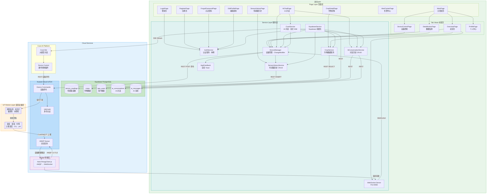
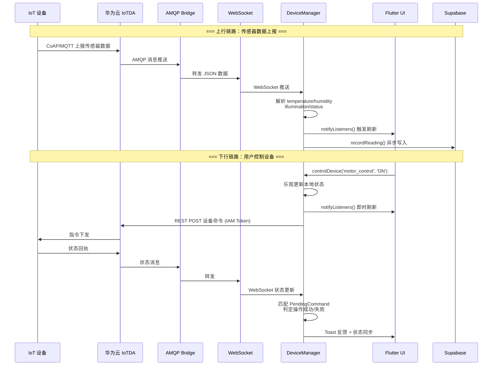
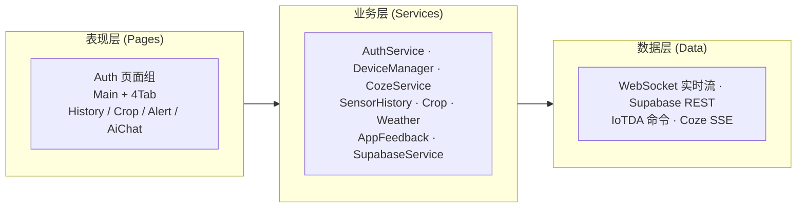

# 禾寻 — 智能农业物联网 App

基于 Flutter 开发的智能农业物联网移动端应用，连接华为云 IoTDA 设备管理平台与 Supabase 云数据库，
集成 **扣子 (Coze) AI 大模型**实现自然语言对话、控制硬件设备与对话历史管理。
实现温室大棚传感器数据实时监测、设备远程控制、历史趋势分析、作物管理与天气服务。
内置 Supabase Auth 认证系统（注册/登录/忘记密码/个人资料编辑），支持自动登录与 JWT 会话管理。

---

## 系统架构



### 数据流转图



### 三层架构总览



### 数据流转

1. **上行（设备 → App）**：温室传感器通过 CoAP/MQTT 上报数据至华为云 IoTDA → 经 AMQP 队列推送至
   `HwIoTAmqpClient.js` Node.js 桥接服务 → 通过 WebSocket 广播给 Flutter App → `DeviceManager`
   解析并更新状态、触发 UI 刷新，同时异步写入 Supabase `sensor_readings` 表
2. **下行（App → 设备）**：用户在 App 中触发设备控制 → `DeviceManager` 调用华为云 IAM 鉴权 → 通过 IoTDA
   REST API 下发设备命令 → 设备执行 → 状态回执经上行链路反馈 → App 匹配挂起命令并展示操作结果 Toast
3. **AI 对话控制（App ↔ AI → 设备）**：用户在 `AiChatPage` 中通过自然语言指令（如"打开通风电机"）→
   `CozeService` 流式请求 Coze Bot → Bot 调用硬件控制插件 → 插件通过 IoTDA REST API 下发设备命令 →
   操作结果反馈至对话页面，同时同步 `DeviceManager` 状态
4. **业务数据**：App 通过 Supabase REST API 读写 `crops`、`sensor_readings`、`profiles`、
   `ai_conversations`、`ai_messages` 表，支持传感器历史趋势查询、作物信息管理、用户认证与 AI 对话历史

---

## 技术路线

| 层级              | 技术栈                | 版本                        |
| ----------------- | --------------------- | --------------------------- |
| **UI 框架**       | Flutter (Dart)        | SDK ≥3.11.5 / Flutter ≥3.38 |
| **HTTP 客户端**   | dio                   | ^5.9.2                      |
| **WebSocket**     | web_socket_channel    | ^3.0.3                      |
| **数据可视化**    | fl_chart              | ^1.2.0                      |
| **Markdown 渲染** | flutter_markdown_plus | ^1.0.7                      |
| **云数据库**      | Supabase (PostgreSQL) | supabase_flutter ^2.12.0    |
| **用户认证**      | Supabase Auth         | JWT + RLS                   |
| **密码加密**      | crypto                | ^3.0.7                      |
| **本地存储**      | shared_preferences    | ^2.5.0                      |
| **AI 大模型**     | 扣子 Coze (字节跳动)  | API v3 / SSE 流式           |
| **物联网平台**    | 华为云 IoTDA          | IAM + 设备接入              |
| **消息桥接**      | Node.js (rhea + ws)   | AMQP 1.0 → WebSocket        |
| **代码规范**      | flutter_lints         | ^6.0.0                      |
| **CI/CD**         | GitHub Actions        | Android APK 手动构建        |
| **构建工具**      | Gradle (Kotlin DSL)   | AGP 8.11.1 / Kotlin 2.2.20  |

---

## 目录结构

```
smart_farm_flutter/
├── lib/
│   ├── main.dart                          # 应用入口，初始化 Supabase Auth + 自动登录
│   ├── config/
│   │   ├── config.dart                    # 运行配置（已 gitignore，包含真实密钥）
│   │   └── config_example.dart            # 配置模板
│   ├── models/
│   │   ├── app_user.dart                  # 用户模型（含昵称、头像、简介等）
│   │   ├── crop.dart                      # 作物数据模型（26 字段）
│   │   ├── sensor_trend_point.dart        # 传感器趋势点模型
│   │   └── ai_conversation.dart           # AI 对话/消息模型
│   ├── routes/
│   │   └── route.dart                     # 路由表 + MaterialApp 配置
│   ├── services/
│   │   ├── auth_service.dart              # 认证服务（Supabase Auth 注册/登录/忘记密码/自动登录）
│   │   ├── weather_service.dart           # 天气服务（高德 API + 本地缓存）
│   │   ├── device_manager.dart            # 设备管理核心（ChangeNotifier）
│   │   ├── supabase_service.dart          # Supabase 初始化服务
│   │   ├── sensor_history_service.dart    # 传感器历史数据 CRUD
│   │   ├── crop_service.dart              # 作物数据服务
│   │   ├── coze_service.dart              # 扣子 Coze AI 对话服务（SSE 流式）
│   │   ├── ai_conversation_service.dart   # AI 对话历史 CRUD
│   │   └── app_feedback.dart              # 全局 Toast 通知
│   └── pages/
│       ├── login_page.dart                # 登录页（邮箱 + 密码）
│       ├── register_page.dart             # 注册页（邮箱/用户名/密码）
│       ├── forgot_password_page.dart      # 忘记密码页（邮箱验证重置）
│       ├── edit_profile_page.dart         # 编辑资料页（昵称/头像/简介/邮箱）
│       ├── main_page.dart                 # 主页（底部 4 Tab + AI 对话入口）
│       ├── sensor_history_page.dart       # 传感器历史查询（日历 + 趋势图）
│       ├── crop_detail_page.dart          # 作物详情页
│       ├── ai_chat_page.dart              # AI 对话页（Markdown 渲染 + 流式打字 + 硬件控制）
│       └── pageViews/
│           ├── overview_page.dart         # 总览页（农场概览 + 天气卡片 + 大棚卡片）
│           ├── device_control_page.dart   # 设备控制页
│           ├── data_monitor_page.dart     # 数据监测页（实时 + 趋势）
│           ├── alert_center_page.dart     # 告警中心页（一键操作 + 设备跳转）
│           └── profile_page.dart          # 个人中心页（用户信息 + 退出登录）
├── android/                               # Android 原生工程（含 v21/v31 启动屏 + 暗色模式）
├── assets/
│   ├── img/                               # 图片资源（logo / avatar / 图标）
│   └── iot_amqp/
│       ├── HwIoTAmqpClient.js             # AMQP-WebSocket 桥接服务
│       └── package.json
├── .github/
│   └── workflows/
│       └── build-android.yml              # GitHub Actions CI（手动触发 Android APK 构建）
├── supabase/
│   ├── schema.sql                         # sensor_readings 建表 + RLS
│   ├── schema_extra.sql                   # crops + app_users 建表 + RLS
│   ├── ai_chat_schema.sql                 # ai_conversations + ai_messages 建表
│   ├── auth_migration.sql                 # Supabase Auth 迁移 + profiles 表 + RLS 策略
│   └── cleanup.sql                        # 30 天数据清理脚本
├── test/
│   └── widget_test.dart                   # 基础 Widget 测试
├── pubspec.yaml
├── .gitignore
└── README.md
```

---

## 核心模块实现

### 1. DeviceManager — 设备管理核心

位置：`lib/services/device_manager.dart`

- **单例模式** + `ChangeNotifier`：全局唯一实例，状态变更时自动通知所有监听 Widget 刷新 UI
- **IAM 认证**：通过华为云 IAM Token API 获取临时令牌，用于后续设备命令调用的鉴权
- **WebSocket 实时数据**：连接至 `HwIoTAmqpClient.js` 建立的 WebSocket 服务，持续接收传感器数据
  JSON，解析并更新 `temperature` / `humidity` / `illumination` / `motorStatus` / `lightStatus` 等状态字段
- **乐观 UI 更新**：用户触发设备开关时，先更新本地状态让 UI 立即响应，再异步发送 REST 命令
- **命令保护窗口（5 秒）**：引入 `_PendingDeviceCommand` 机制，记录每个命令的期望状态和时间戳。在保护窗口内忽略
  WebSocket 回放的旧状态，避免把乐观更新刷回旧值
- **操作反馈**：命令完成或超时后，通过 `AppFeedback.showAppToast()` 弹出成功（绿色）/失败（红色）SnackBar
- **自动记录传感器读数**：每次接收到传感器数据时，调用 `SensorHistoryService.recordReading()` 将数据异步写入
  Supabase

### 2. SupabaseService — 云数据库初始化

位置：`lib/services/supabase_service.dart`

- 惰性初始化：在 `main.dart` 的 `main()` 函数中调用 `SupabaseService.initialize()`
- 配置检查：若 `Config.supabaseUrl` 或 `Config.supabaseAnonKey` 为空则跳过初始化
- 全局访问：通过 `SupabaseService.maybeClient` 获取 `SupabaseClient` 实例，各业务 Service 按需调用

### 3. SensorHistoryService — 传感器历史数据服务

位置：`lib/services/sensor_history_service.dart`

| 方法                    | 功能                                                                                                  |
| ----------------------- | ----------------------------------------------------------------------------------------------------- |
| `recordReading()`       | 将传感器读数写入 `sensor_readings` 表，内置 1 分钟去重防抖                                            |
| `fetchTrend()`          | 按时间范围（24h/7d/30d）查询数据并分桶聚合（24h 按小时、7d 按星期、30d 按日期），返回折线图所需数据点 |
| `fetchRecords()`        | 支持起止日期筛选、升降序、分页（limit）的传感器历史记录查询                                           |
| `fetchAvailableDates()` | 查询所有有数据的日期，为日历组件提供可选日期标记                                                      |

- 土壤湿度兜底估算：若无直接传感器读数，通过温度与湿度的经验公式 `75 - (temp-22)×2 + (hum-60)×0.5`
  估算，并钳位至 [10, 95]

### 4. CropService — 作物数据服务

位置：`lib/services/crop_service.dart`

- 查询 Supabase `crops` 表，按 `crop_name` 排序返回所有作物列表
- 每行数据通过 `Crop.fromSupabase()` 工厂构造函数映射到 `Crop` 模型（26 个字段）

### 5. AppFeedback — 全局 Toast 通知

位置：`lib/services/app_feedback.dart`

- 注册全局 `GlobalKey<ScaffoldMessengerState>` 至 `MaterialApp`，实现跨页面 SnackBar 调用
- 根据消息内容自动判定成功（含"成功"字样，绿色 `#1F7A4D`）或失败（红色 `#B9382F`）
- 自定义弹性动画（`easeOutBack` 展开 / `easeInCubic` 收起）、圆角 15px、浮动样式、水平滑动关闭

### 6. AuthService — 用户认证服务（Supabase Auth）

位置：`lib/services/auth_service.dart`

迁移至 Supabase Auth (GoTrue)，使用 JWT 会话管理替代自定义 SHA-256 密码表。核心能力：

| 方法                  | 功能                                                                   |
| --------------------- | ---------------------------------------------------------------------- |
| `login()`             | 邮箱 + 密码登录，获取 Supabase Auth JWT session                        |
| `register()`          | 邮箱 + 密码 + 用户名注册，自动创建 `profiles` 记录（触发器实现）       |
| `resetPassword()`     | 发送重置密码邮件至注册邮箱                                             |
| `checkAutoLogin()`    | App 启动时通过 `Supabase.instance.client.auth.currentSession` 静默恢复 |
| `logout()`            | 清除 Supabase session + 本地缓存                                       |
| `updateProfile()`     | 更新 `public.profiles` 表中的昵称、头像 URL、简介、邮箱等              |
| `getUserByUsername()` | 按用户名查询用户记录                                                   |

- **认证机制**：基于 Supabase GoTrue JWT，密码哈希与安全策略完全由 Supabase Auth 托管
- **自动注册触发器**：`auth.users` 插入新行后，`handle_new_user()` 自动同步创建 `public.profiles` 行
- **RLS 策略**：`profiles` 表仅允许 `auth.uid()` 匹配时进行 SELECT / INSERT / UPDATE
- **自动登录**：App 启动时检测当前 session；有效则直接进入主页，无效则跳转登录页
- **关联表**：`public.profiles`（id UUID PK 关联 `auth.users`）存储用户扩展信息

### 7. WeatherService — 天气服务

位置：`lib/services/weather_service.dart`

- 对接高德天气 API，获取当前城市的天气实况（天气现象、温度、风力、湿度）
- 本地缓存机制：天气数据缓存至 `SharedPreferences`，网络失败时回退到缓存
- 30 秒刷新间隔：避免频繁请求 API
- 通过 `singleChildScrollView` 的 `GlobalKey` 触发首页天气卡片刷新

### 8. CozeService — AI 对话服务（流式 SSE）

位置：`lib/services/coze_service.dart`

基于扣子 (Coze) API v3 的大模型对话引擎，支持流式 SSE (Server-Sent Events) 实时响应。

| 特性             | 说明                                                                           |
| ---------------- | ------------------------------------------------------------------------------ |
| **流式对话**     | SSE 模式逐字打字输出，支持 `reasoning`（推理过程）和 `delta`（正文）两种事件流 |
| **对话管理**     | 维护 `conversationId` 自动上下文衔接；`startNewChat()` 清除会话                |
| **历史上下文**   | 每次请求携带最近 20 轮对话作为 `additional_messages`，避免上下文丢失           |
| **硬件控制集成** | Coze Bot 配置了硬件控制插件，AI 可直接调用华为云 IoTDA REST API 下发设备指令   |
| **错误处理**     | `DioException` 统一捕获，解析 Coze API 返回的 `msg`/`message` 错误提示         |

**事件类型**：`delta`（流式增量文本）、`reasoning`（推理过程文本）、`completed`（单条消息完成）、`done`（会话结束）、`error`（异常）、`deviceControl`（硬件控制）

### 9. AiConversationService — AI 对话历史 CRUD

位置：`lib/services/ai_conversation_service.dart`

管理 AI 对话的持久化存储，将对话会话与消息同步至 Supabase。

| 方法                   | 功能                                            |
| ---------------------- | ----------------------------------------------- |
| `createConversation()` | 创建新对话（UUID v4），关联 `auth_user_id`      |
| `updateConversation()` | 更新对话标题与 `coze_conversation_id`           |
| `deleteConversation()` | 级联删除对话及所有消息（`ON DELETE CASCADE`）   |
| `fetchConversations()` | 按 `updated_at DESC` 查询当前用户的所有对话列表 |
| `fetchMessages()`      | 按 `created_at ASC` 查询指定对话的全部消息      |
| `insertMessage()`      | 插入单条用户/助手消息                           |
| `insertMessages()`     | 批量插入消息（用于恢复历史）                    |

### 10. AiChatPage — AI 对话页面

位置：`lib/pages/ai_chat_page.dart`（1176 行）

核心 UI 页面，提供类 ChatGPT 的对话体验。

| 特性              | 说明                                                                                  |
| ----------------- | ------------------------------------------------------------------------------------- |
| **Markdown 渲染** | 使用 `flutter_markdown_plus` 渲染 AI 回复（支持代码块、表格、列表等）                 |
| **流式打字效果**  | 实时展示 AI 逐字输出，`_ChatMessage` 状态对象跟踪 `reasoningContent` 与正文 `content` |
| **推理过程展开**  | 可折叠的"思考中"区域，展示 Coze Bot 的 reasoning 推理链                               |
| **对话历史列表**  | 侧边栏展示历史对话列表，支持创建/选择/删除对话，按最后更新时间排序                    |
| **硬件控制反馈**  | AI 触发设备控制后，自动调用 `DeviceManager` 执行命令并通过 Toast 反馈操作结果         |
| **自动滚动**      | 新消息到达时自动滚动到底部                                                            |
| **路由**          | `/ai-chat`（从主页面右上角 AI 图标进入）                                              |

### 11. AMQP-WebSocket 桥接服务 (Node.js)

位置：`assets/iot_amqp/HwIoTAmqpClient.js`

- 使用 `rhea` 库通过 AMQP 1.0 over TLS 连接华为云 IoTDA 的消息队列
- 监听 `DefaultQueue`，接收 IoT 设备上报的遥测数据
- 使用 `ws` 库启动本地 WebSocket 服务（端口 8083），将 AMQP 消息实时转发给 Flutter App
- 内建 3 秒心跳保活与自动重连机制

### 12. 数据库设计（Supabase PostgreSQL）

**sensor_readings（传感器读数表）**

| 列            | 类型             | 说明                              |
| ------------- | ---------------- | --------------------------------- |
| id            | bigint (PK)      | 自增主键                          |
| greenhouse    | text             | 大棚标识（如 `east-suburb-farm`） |
| temperature   | double precision | 温度 (°C)                         |
| humidity      | double precision | 湿度 (%)                          |
| illumination  | double precision | 光照 (Lux)                        |
| soil_moisture | double precision | 土壤湿度 (%)                      |
| co2           | double precision | CO₂ 浓度 (ppm)                    |
| ph_value      | double precision | pH 值                             |
| recorded_at   | timestamptz      | 记录时间 (UTC)                    |

索引：`(greenhouse, recorded_at DESC)` 复合索引

**crops（作物表）**：26 个字段，含种植信息、环境分析评分、任务时间等

**app_users（用户表）**：用户名、密码、昵称、联系方式、农场绑定（遗留表，已迁移至 Supabase Auth `profiles`）

**profiles（用户扩展信息表 — Supabase Auth）**

| 列         | 类型        | 说明                            |
| ---------- | ----------- | ------------------------------- |
| id         | uuid (PK)   | 关联 `auth.users(id)`，级联删除 |
| username   | text (UQ)   | 用户名（唯一）                  |
| email      | text        | 邮箱                            |
| nickname   | text        | 昵称                            |
| avatar_url | text        | 头像 URL                        |
| bio        | text        | 个人简介                        |
| phone      | text        | 手机号                          |
| profession | text        | 职业                            |
| farm       | text        | 所属农场                        |
| created_at | timestamptz | 创建时间                        |
| updated_at | timestamptz | 更新时间                        |

**ai_conversations（AI 对话表）**

| 列                   | 类型        | 说明                           |
| -------------------- | ----------- | ------------------------------ |
| id                   | uuid (PK)   | 对话 ID（UUID v4）             |
| user_id              | text        | 用户标识（兼容历史）           |
| auth_user_id         | uuid        | 关联 `auth.users(id)`          |
| title                | text        | 对话标题                       |
| coze_conversation_id | text        | Coze 平台对话 ID（上下文保持） |
| created_at           | timestamptz | 创建时间                       |
| updated_at           | timestamptz | 最后更新时间                   |

索引：`(auth_user_id, updated_at DESC)` 复合索引

**ai_messages（AI 消息表）**

| 列              | 类型        | 说明                        |
| --------------- | ----------- | --------------------------- |
| id              | bigint (PK) | 自增主键                    |
| conversation_id | uuid (FK)   | 关联 `ai_conversations(id)` |
| role            | text        | `user` 或 `assistant`       |
| content         | text        | 消息内容                    |
| created_at      | timestamptz | 创建时间                    |

外键约束：`ON DELETE CASCADE`，删除对话时级联删除消息
索引：`(conversation_id, created_at)` 复合索引

所有表启用 **Row Level Security (RLS)**，AI 相关表使用 `authenticated` 角色 + `auth.uid()` 进行用户隔离。

---

## 页面说明

| 页面                   | 路由               | 功能                                                                                             |
| ---------------------- | ------------------ | ------------------------------------------------------------------------------------------------ |
| **LoginPage**          | `/login`           | 邮箱 + 密码登录（Supabase Auth）；记住密码；注册/忘记密码入口；三方登录入口（微信/QQ）           |
| **RegisterPage**       | `/register`        | 用户注册：邮箱、用户名、密码、确认密码；自动创建 Supabase Auth 账户 + profiles 记录              |
| **ForgotPasswordPage** | `/forgot-password` | 邮箱验证 + 新密码重置（Supabase Auth）                                                           |
| **EditProfilePage**    | `/edit-profile`    | 编辑个人资料：昵称、头像 URL、简介、邮箱、手机号、职业                                           |
| **MainPage**           | `/main`            | 底部导航 4 Tab：总览、设备控制、数据监测、我的；右上角 AI 对话入口                               |
| **OverviewPage**       | Tab 1              | 动态农场名；设备在线/告警统计；24h 环境均值卡片；高德天气卡片（优秀/良好颜色区分）；大棚卡片列表 |
| **DeviceControlPage**  | Tab 2              | 按设备类型筛选 Tab；设备卡片含属性、运行时长、开关控制（通风/补光走真实 IoTDA，灌溉/水肥为模拟） |
| **DataMonitorPage**    | Tab 3              | 实时数据卡片（温/湿/土/光）；趋势折线图（24h/7d/30d）；跳转历史查询入口                          |
| **ProfilePage**        | Tab 4              | 用户信息展示（头像/昵称/简介/手机/邮箱）；农场卡片；设置菜单；编辑资料入口；退出登录             |
| **AiChatPage**         | `/ai-chat`         | AI 对话：流式打字 + Markdown 渲染 + 推理过程展开；硬件控制集成；对话历史管理；侧边栏对话列表     |
| **SensorHistoryPage**  | `/sensor-history`  | 自定义日历日期选择器；起止日期筛选；记录数量限制；fl_chart 趋势折线图；详细记录列表              |
| **CropDetailPage**     | 导航进入           | 作物基本信息；生长进度条；环境分析 5 维评分；问题与建议卡片                                      |
| **AlertCenterPage**    | `/alert`           | 告警统计卡片；未处理/已处理筛选；一键灌溉/通风；查看设备跳转；左滑忽略持久化；随机生成告警       |

---

## 快速开始

### 前置条件

- Flutter SDK ≥3.38
- Android Studio / VS Code + Flutter 插件
- Node.js (用于运行 AMQP 桥接服务)
- 华为云 IoTDA 实例 + Supabase 项目

### 1. 克隆项目

```bash
git clone <repo-url>
cd smart_farm_flutter
```

### 2. 配置密钥

复制配置模板并填入真实密钥：

```bash
cp lib/config/config_example.dart lib/config/config.dart
```

编辑 `lib/config/config.dart`，填入：

- `supabaseUrl` / `supabaseAnonKey` / `supabaseServiceRoleKey`：Supabase 项目密钥
- `supabaseGreenhouse`：默认大棚标识（如 `east-suburb-farm`）
- `iamUser` / `iamPassword` / `iamDomain`：华为云 IAM 账号信息
- `iamProject`：华为云 IAM 项目（如 `cn-north-4`）
- `iotCommandUrl` / `iotInstanceId` / `iotServiceId`：华为云 IoTDA 实例信息
- `webSocketUrl`：AMQP 桥接服务的 WebSocket 地址
- `amapWeatherUrl` / `amapAuthKey`：高德天气 API 密钥
- `cozeApiUrl` / `cozeApiToken` / `cozeBotId`：扣子 Coze AI 平台配置

### 3. 初始化 Supabase 数据库

在 Supabase SQL Editor 中依次执行：

```sql
-- 创建传感器读数表
\i supabase/schema.sql

-- 创建作物表与用户表
\i supabase/schema_extra.sql

-- 创建 AI 对话与消息表
\i supabase/ai_chat_schema.sql

-- 执行 Supabase Auth 迁移（profiles 表 + RLS + 触发器）
\i supabase/auth_migration.sql
```

### 4. 启动 AMQP 桥接服务

```bash
cd assets/iot_amqp
npm install
node HwIoTAmqpClient.js
```

### 5. 运行 Flutter App

```bash
flutter pub get
flutter run
```

### 构建 APK

```bash
flutter build apk --release
```

---

## CI/CD

项目使用 GitHub Actions 实现 Android APK 自动构建（手动触发）。

工作流文件：`.github/workflows/build-android.yml`

| 步骤               | 说明                                                                |
| ------------------ | ------------------------------------------------------------------- |
| Checkout           | 拉取仓库代码                                                        |
| Set up Java 17     | 安装 Temurin JDK 17                                                 |
| Set up Flutter     | 安装 Flutter 3.41.x (stable)                                        |
| Create config.dart | 通过 GitHub Secrets 注入运行时配置（Supabase / IAM / IoTDA / Coze） |
| Install deps       | `flutter pub get`                                                   |
| Generate splash    | `dart run flutter_native_splash:create`                             |
| Build APK          | `flutter build apk --release`                                       |
| Upload artifact    | 上传 `app-release.apk` 至 GitHub Artifacts（保留 30 天）            |

### 触发方式

在 GitHub 仓库的 **Actions → Build Android APK → Run workflow** 手动触发。

### 所需 Secrets

`SUPABASE_URL`, `SUPABASE_ANON_KEY`, `SUPABASE_GREENHOUSE`, `IAM_AUTH_URL`, `IAM_USER`, `IAM_PASSWORD`, `IAM_DOMAIN`, `IAM_PROJECT`, `IOT_COMMAND_URL`, `IOT_INSTANCE_ID`, `IOT_SERVICE_ID`, `WEB_SOCKET_URL`, `AMAP_WEATHER_URL`, `AMAP_AUTH_KEY`, `COZE_API_URL`, `COZE_API_TOKEN`, `COZE_BOT_ID`

---

## 注意事项

- `lib/config/config.dart` 包含真实密钥，已加入 `.gitignore`，请勿提交至版本库
- AMQP 桥接服务 `HwIoTAmqpClient.js` 需要在能访问华为云 IoTDA 的服务器上运行
- Supabase Auth 迁移脚本 `supabase/auth_migration.sql` 可重复执行（使用 `if not exists` / `drop policy if exists`）
- AI 对话功能依赖扣子 (Coze) Bot 配置了硬件控制插件才能下达 IoTDA 设备指令
- `test/widget_test.dart` 为 Flutter 脚手架默认测试模板，需根据实际 App UI 重写

---

## License

MIT
